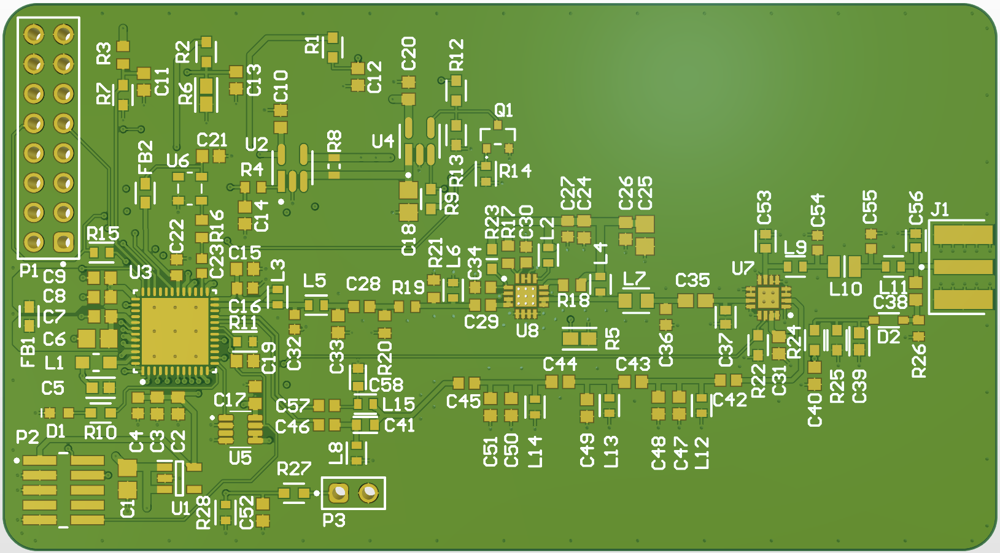
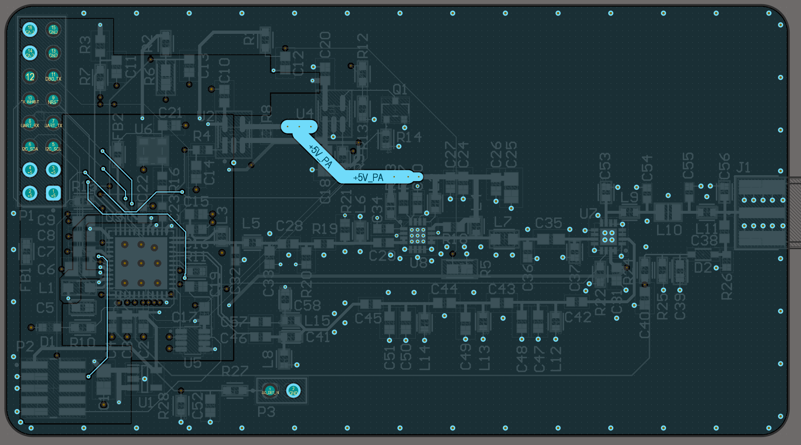
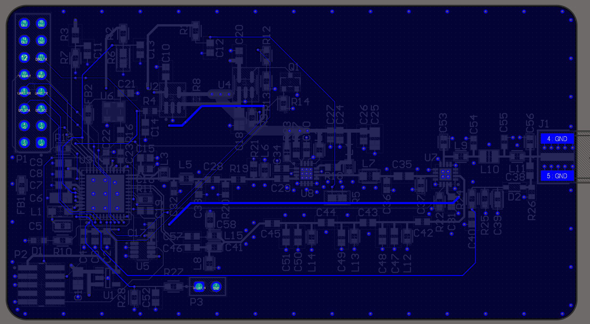

# QUASAR

**A 436.5 MHz UHF transceiver for CubeSats - designed and built solo.**



QUASAR is an independent project by Rayaan Atif, an Engineering and Physics student at Curtin University in Perth, Western Australia. The goal is a compact, low-cost UHF radio for small satellites that can be built and tested by one person - from schematic and layout through bring-up, RF testing and the ground station.

> **Status:** transceiver schematic and 4-layer layout complete, in final review before fabrication. Not yet built or tested. A companion deployable antenna board is in design.

---

## Transceiver at a glance

| | |
|---|---|
| Frequency | 436.5 MHz (70 cm amateur-satellite band) |
| Output power | ~1.5-2 W (target) |
| Radio / MCU | STM32WLE5CCU6 (sub-GHz radio + Arm Cortex-M4 in one chip) |
| Power amplifier | Guerrilla RF GRF5504, with drive stage and matching |
| T/R switch | pSemi PE42553 - defaults to receive at power-up |
| Transmit filter | 7-pole Chebyshev low-pass filter (0.1 dB ripple) |
| Receive path | 3-pole band-pass filter + lattice balun into the radio's differential input |
| Reference clock | 32 MHz TCXO |
| Telemetry | PA current (INA180 + 0.1 Ω shunt), supply voltage, PA and board temperature (NTCs), forward-power detector, antenna isolated-port detector |
| Safety | PA power through a TPS2065C load switch: off by default, with a hardware TX_INHIBIT line that overrides the MCU |
| Reliability | MAX6369 external watchdog, status LED |
| Interfaces | 16-pin OBC header (5 V, I2C, UART, TX_INHIBIT, NRST), 10-pin SWD, antenna-board detect port |
| PCB | 4-layer, ~85 x 45 mm, JLCPCB JLC04161H-7628 impedance-controlled stack-up |

## Schematic

[QUASAR_TRX_schematic.pdf](hardware/transceiver/QUASAR_TRX_schematic.pdf) - the full transceiver on one sheet, grouped by function:
connectors, power and filtering, current/voltage/temperature sensing, clock / reset / status, MCU and radio, load switch and TX inhibit, drive stage, power amplifier, T/R switch, RX filter and balun, antenna low-pass filter, RF detectors and the antenna connector.

## PCB layout

The board uses a four-layer stack-up chosen for RF performance:

| Layer | Use |
|---|---|
| L1 (top) | All components, RF and signal routing, ground pour |
| L2 | Solid, unbroken ground - the reference plane for every 50 Ω track |
| L3 | Power islands (+5 V, +3.3 V, +1.55 V, +5 V PA) with ground fill |
| L4 (bottom) | Low-speed signals and ground pour |

Layout features:
- 50 Ω microstrip on L1 over the solid L2 ground, impedance-controlled by the fab
- Ground via fences along the RF path and around the board edge
- Via array under the PA's exposed pad plus a ring of thermal vias for heat spreading
- Transmit and receive paths kept physically separate
- Wide, multi-via feed for the PA supply

| Layer 1 - top / RF | Layer 2 - ground |
|---|---|
|  |  |
| **Layer 3 - power** | **Layer 4 - bottom** |
|  |  |

## Roadmap

- [x] Transceiver schematic
- [x] Transceiver 4-layer layout
- [ ] Final design review and fabrication
- [ ] Bring-up: power rails, MCU, clock, telemetry
- [ ] RF testing: output power, harmonics and spurious, receive sensitivity, VNA match tuning
- [ ] Deployable antenna board (circularly polarised turnstile with tape-spring elements)
- [ ] Firmware and ground-station integration

## Repository layout

```
hardware/transceiver/   schematic (PDF)
images/transceiver/     3D view and layer screenshots
```

Design files (Altium project, Gerbers, BOM) and test results will be added as the project progresses.

## Author

**Rayaan Atif** - Engineering & Physics, Curtin University, Perth, Australia.
Member of the Perth Aerospace Student Team and the Binar Space Program (BinarX). QUASAR is a personal project and is not affiliated with either.
