# QUASAR

**A 436.5 MHz UHF communications module for CubeSats: a 2 W transceiver and a deployable, circularly polarised turnstile antenna in one shielded stack. Designed and built solo.**

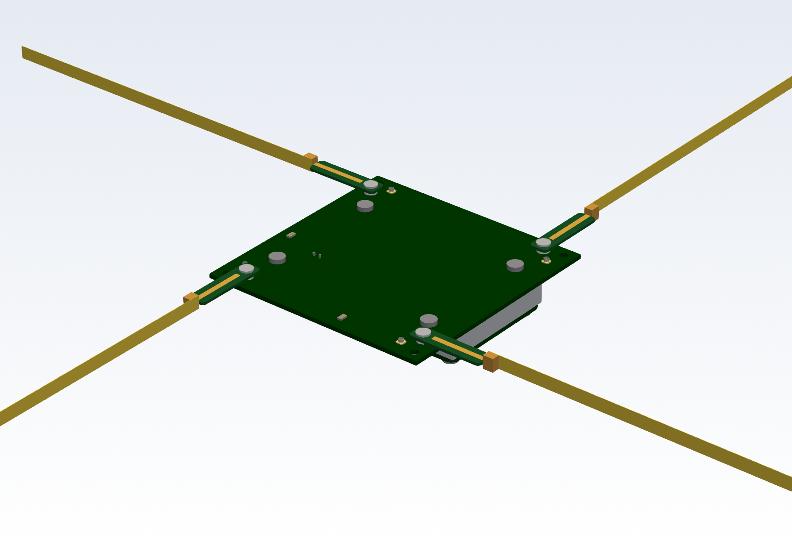

QUASAR is an independent project by Rayaan Atif, an Engineering and Physics student at Curtin University in Perth, Western Australia. The goal is a compact, low-cost UHF radio system for small satellites that one person can design, build and test, from schematic and layout through bring-up, RF testing and the ground station.

> **Status:** transceiver and antenna boards are laid out and in final review before fabrication. Neither board has been built or tested yet; every figure below is a design value.

---

## The module

The two boards stack into a single unit for one 87 x 87 mm face of a CubeSat:

- **Antenna board** on the outside, carrying four spring-deployed tape elements and the feed network.
- **Transceiver** mounted underneath, inside an aluminium shield frame. The antenna board's ground plane is the lid, the frame is the walls and the transceiver's own ground planes are the floor, so the radio sits in a closed RF enclosure without a separate can.
- One short internal U.FL coax links them, so there's no RF cabling outside the shield.

| Stowed | Deployed |
|---|---|
| 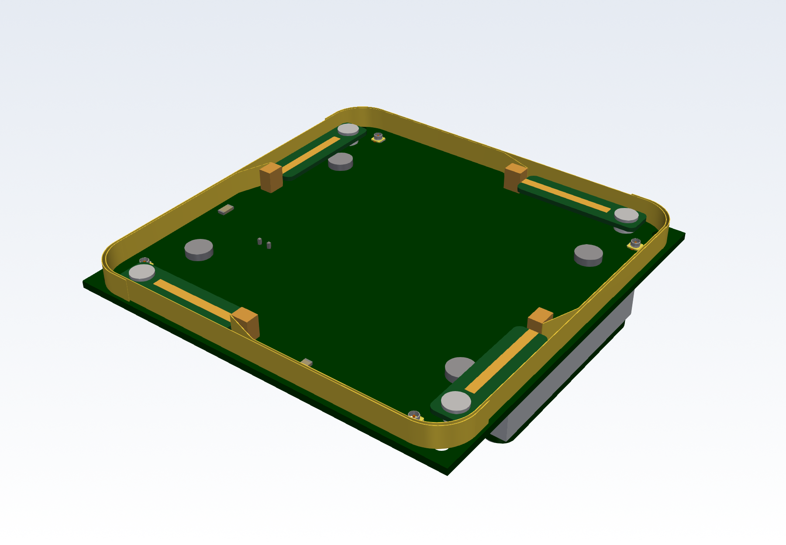 | 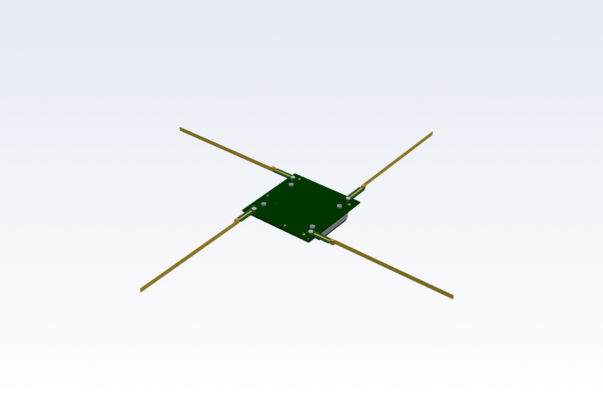 |
| **Exploded, outward side** | **Exploded, underside** |
| 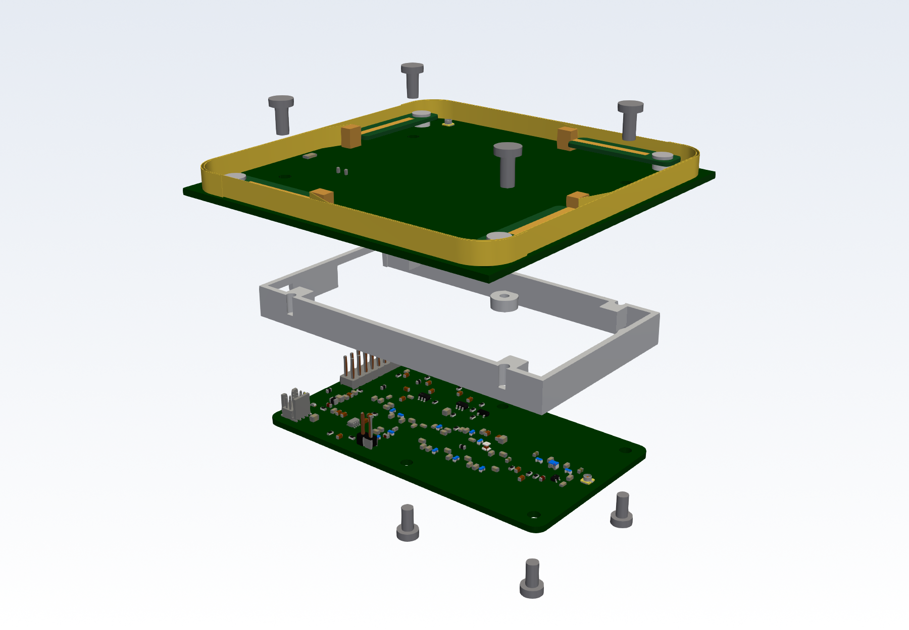 | 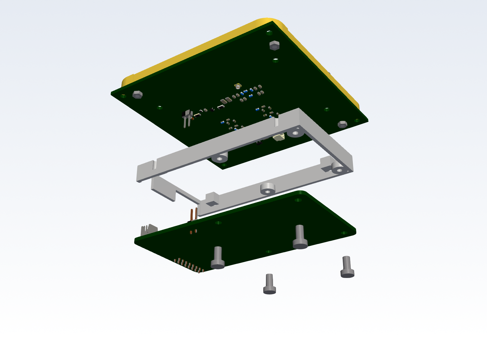 |

| | |
|---|---|
| Footprint | 87 x 87 mm |
| Stack depth | ~11.2 mm (antenna board + 8 mm shield frame + transceiver) |
| Stowed height above the face | ~5.2 mm |
| Deployed span | ~405 mm tip to tip |
| Release | single Dyneema line, cut by two redundant burn resistors |

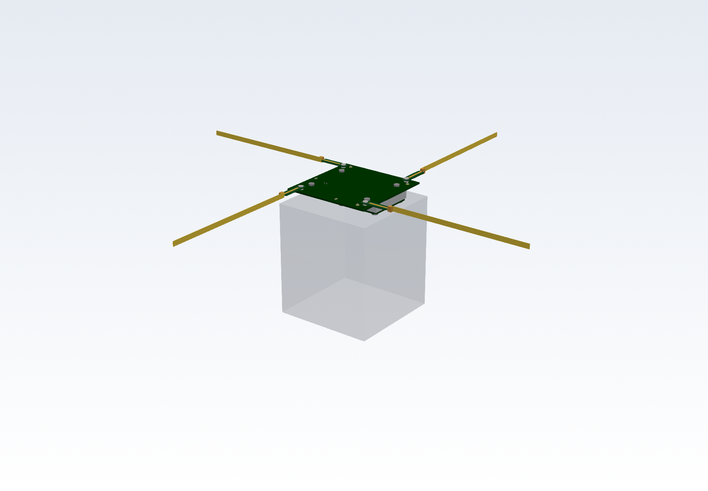

*Renders are generated from the boards' Altium STEP exports plus a parametric model of the frame, hinges and tape elements.*

---

## Transceiver

A complete 70 cm satellite radio on an 85 x 47 mm board: sub-GHz SoC, 2 W power amplifier, filtered TX and RX chains, full health telemetry and a hardware transmit interlock.


| | |
|---|---|
| Frequency | 436.5 MHz (70 cm amateur-satellite band) |
| Output power | ~1.5-2 W (target) |
| Radio / MCU | STM32WLE5CCU6 (sub-GHz radio + Arm Cortex-M4 in one chip) |
| Power amplifier | Guerrilla RF GRF5504, with drive stage and matching |
| T/R switch | pSemi PE42553, defaults to receive at power-up |
| Transmit filter | 7-pole Chebyshev low-pass filter (0.1 dB ripple) |
| Receive path | 3-pole band-pass filter + lattice balun into the radio's differential input |
| Reference clock | 32 MHz TCXO |
| Telemetry | PA current (INA180 + 0.1 Ω shunt), supply voltage, PA and board temperature (NTCs), forward-power detector, antenna isolated-port detector |
| Safety | PA power through a TPS2065C load switch: off by default, with a hardware TX_INHIBIT line that overrides the MCU |
| Reliability | MAX6369 external watchdog, status LED |
| Interfaces | Hirose U.FL antenna port, 16-pin OBC header (5 V, I2C, UART, TX_INHIBIT, NRST), 10-pin SWD, antenna-board detect port |
| PCB | 4-layer, 85 x 47 mm, four plated M3 mounting holes, JLCPCB JLC04161H-7628 impedance-controlled stack-up |

### Schematic

[QUASAR_TRX_schematic.pdf](hardware/transceiver/QUASAR_TRX_schematic.pdf): the full transceiver on one sheet, grouped by function:
connectors, power and filtering, current/voltage/temperature sensing, clock / reset / status, MCU and radio, load switch and TX inhibit, drive stage, power amplifier, T/R switch, RX filter and balun, antenna low-pass filter, RF detectors and the antenna connector.

### Layout

| Layer | Use |
|---|---|
| L1 (top) | All components, RF and signal routing, ground pour |
| L2 | Solid, unbroken ground: the reference plane for every 50 Ω track |
| L3 | Power islands (+5 V, +3.3 V, +1.55 V, +5 V PA) with ground fill |
| L4 (bottom) | Low-speed signals and ground pour |

- 50 Ω lines on L1 over the solid L2 ground, impedance-controlled by the fab
- Ground via fences along the whole RF path, with dedicated vias at every shunt part
- Exposed ground ring and stitching around the board edge for the shield frame
- Via array under the PA's exposed pad for heat spreading
- Transmit and receive paths kept physically separate
- Silkscreen artwork: a Voyager-inspired scene on the top, a Golden Record-style plaque on the bottom

*Top silkscreen adapted from a NASA/ESA Voyager illustration.*

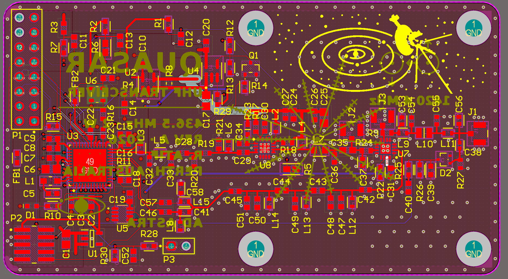

| Layer 1 - top / RF | Layer 2 - ground |
|---|---|
| 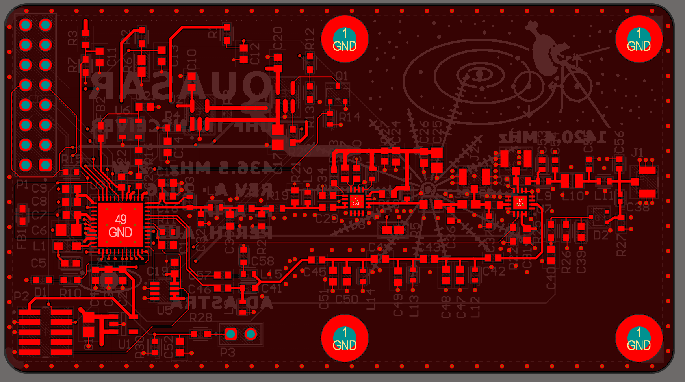 | 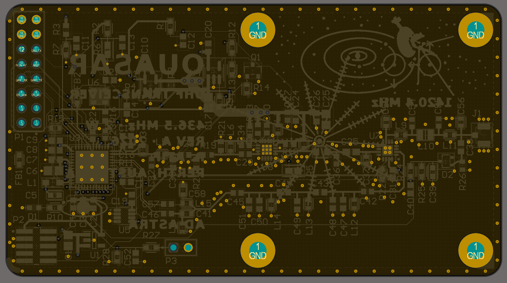 |
| **Layer 3 - power** | **Layer 4 - bottom** |
|  |  |

---

## Antenna board

A deployable turnstile: two crossed dipoles fed 90° apart for circular polarisation, so the link doesn't fade as the satellite tumbles. The board doubles as the shield lid for the transceiver.

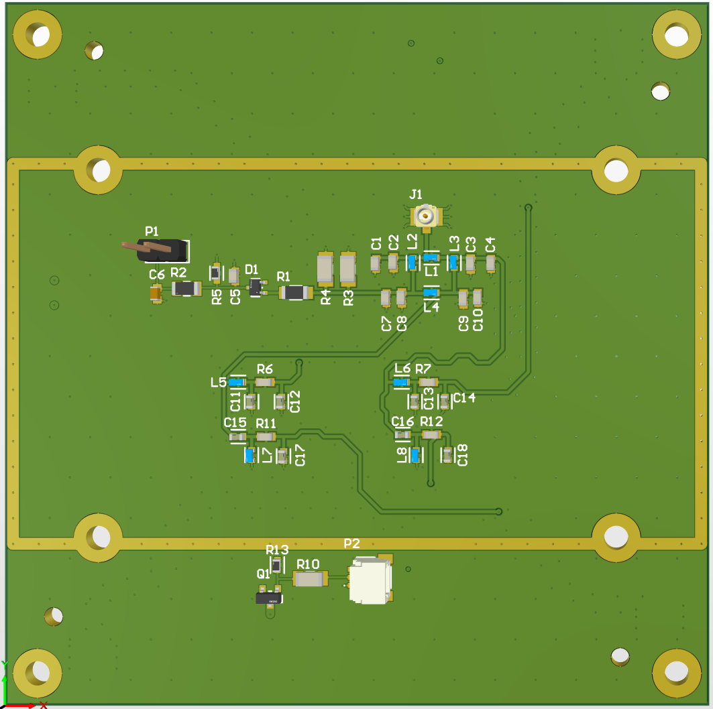

| | |
|---|---|
| Antenna | Turnstile: two crossed half-wave dipoles from four tape-spring elements |
| Polarisation | Circular, from a 0° / 90° / 180° / 270° feed |
| Elements | ~140 mm steel tape on 25 mm hinged FR4 arms; tapes stow edge-on around the board perimeter |
| Deployment | Torsion-spring pivots swing each arm 90° in-plane; one Dyneema tie-down |
| 90° hybrid | Lumped-element branch-line coupler (high-Q 0402 C0G + 0603 wirewound inductors) |
| Baluns | Two lumped lattice baluns, one per dipole |
| Matching | 0 Ω + unfitted shunt pads on every element feed for tuning on a VNA |
| Feed phase matching | All four element feeds length-matched to within 0.05 mm (~65.5 mm each) |
| Health monitoring | Hybrid isolated port terminated in 2 x 100 Ω with a BAT15-04W detector: reflected power from a damaged or undeployed element is reported to the transceiver |
| Release | Two 15 Ω pulse-rated 1206 burn resistors, MOSFET switch with gate pull-down, JST SH connector to the EPS/OBC |
| RF connectors | Hirose U.FL: one input from the transceiver, four element outputs |
| PCB | 4-layer, 87 x 87 mm, JLC04161H-7628 stack-up, four M3 structure holes, 2.2 mm unplated pivot holes |

### Layout

| Layer | Use |
|---|---|
| L1 (inner face) | Hybrid, baluns, detector, release switch, exposed ground ring for the shield frame |
| L2 | Solid ground, the shield lid and RF reference |
| L3 | Ground, plus the burn-wire supply routed clear of every outer-face RF trace |
| L4 (outer face) | Element feeds to the U.FL outputs, burn resistors, ground pour |

- 50 Ω coplanar waveguide with ground on both outer layers, via-fenced end to end
- Each dipole half switches layer once, so the X and Y feeds never cross
- Feed vias kept inside the shield ring; nothing RF passes under the frame wall
- Dense ground stitching across both faces and around the shield ring

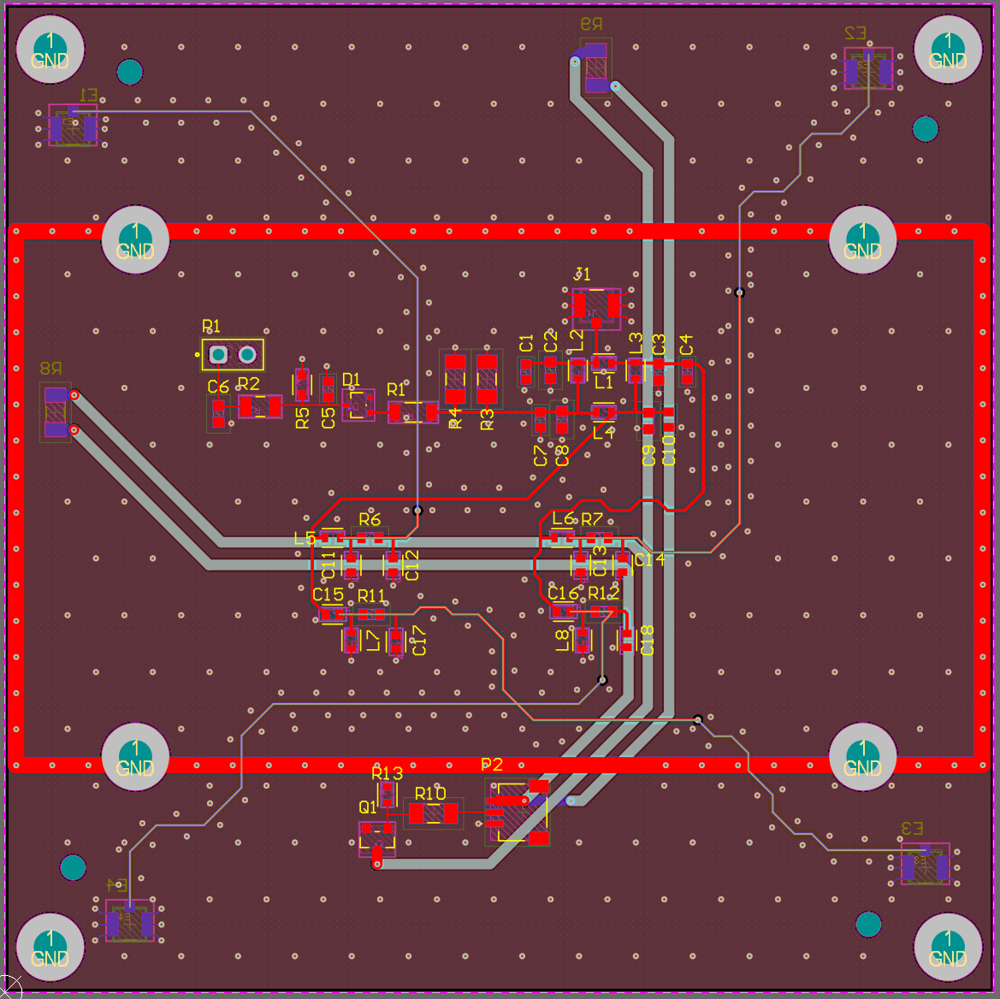

| Layer 1 - inner face / RF | Layer 2 - ground |
|---|---|
| 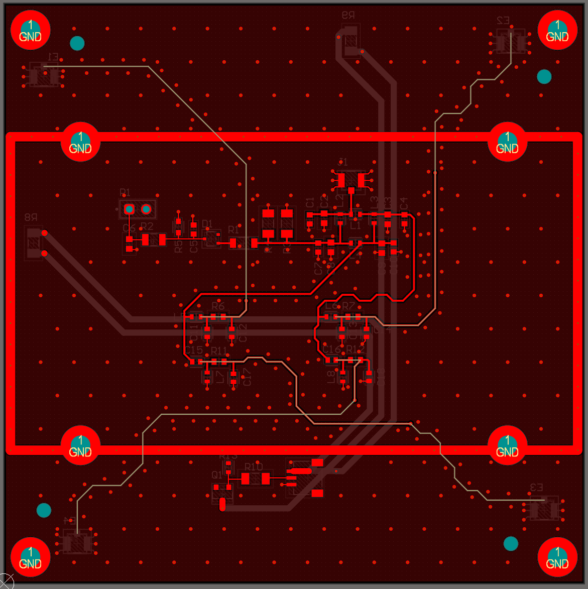 | 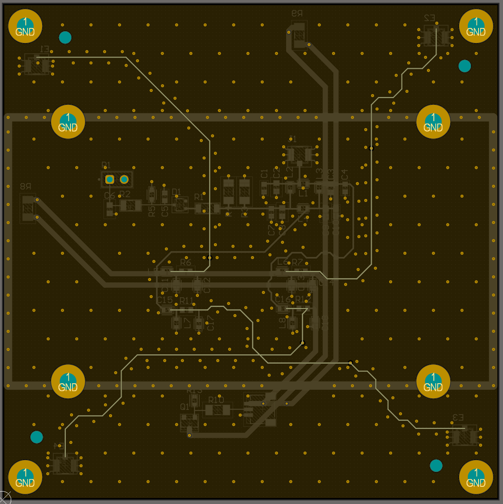 |
| **Layer 3 - ground / burn supply** | **Layer 4 - outer face** |
| 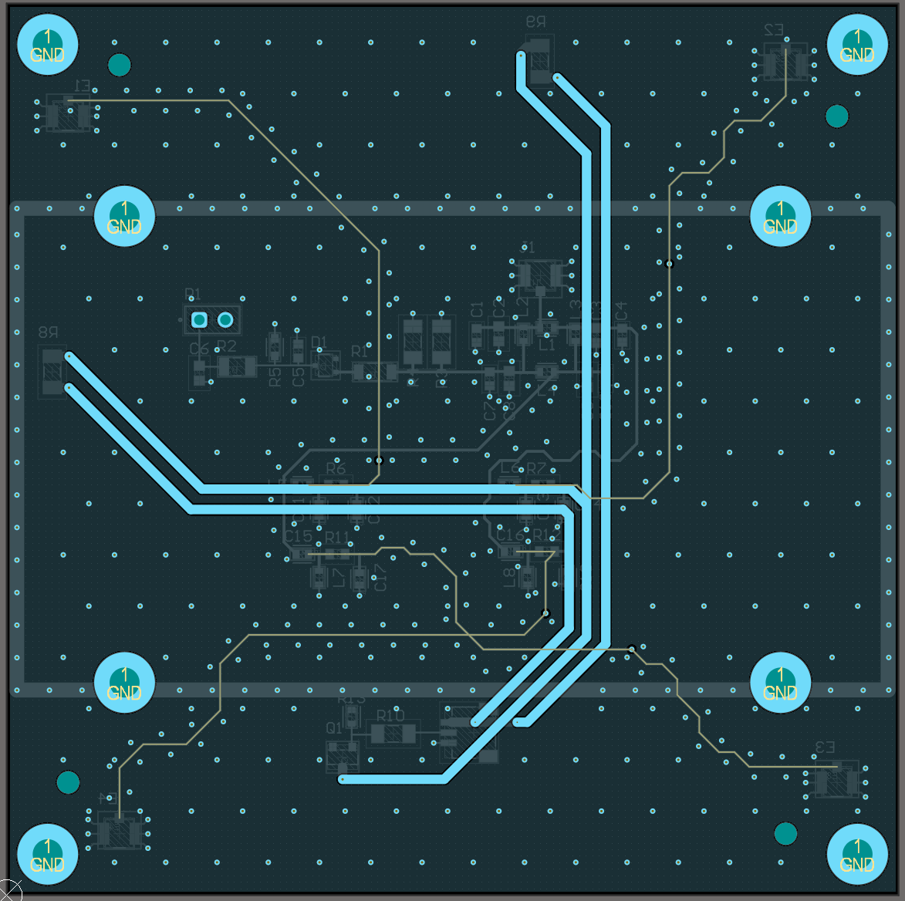 | 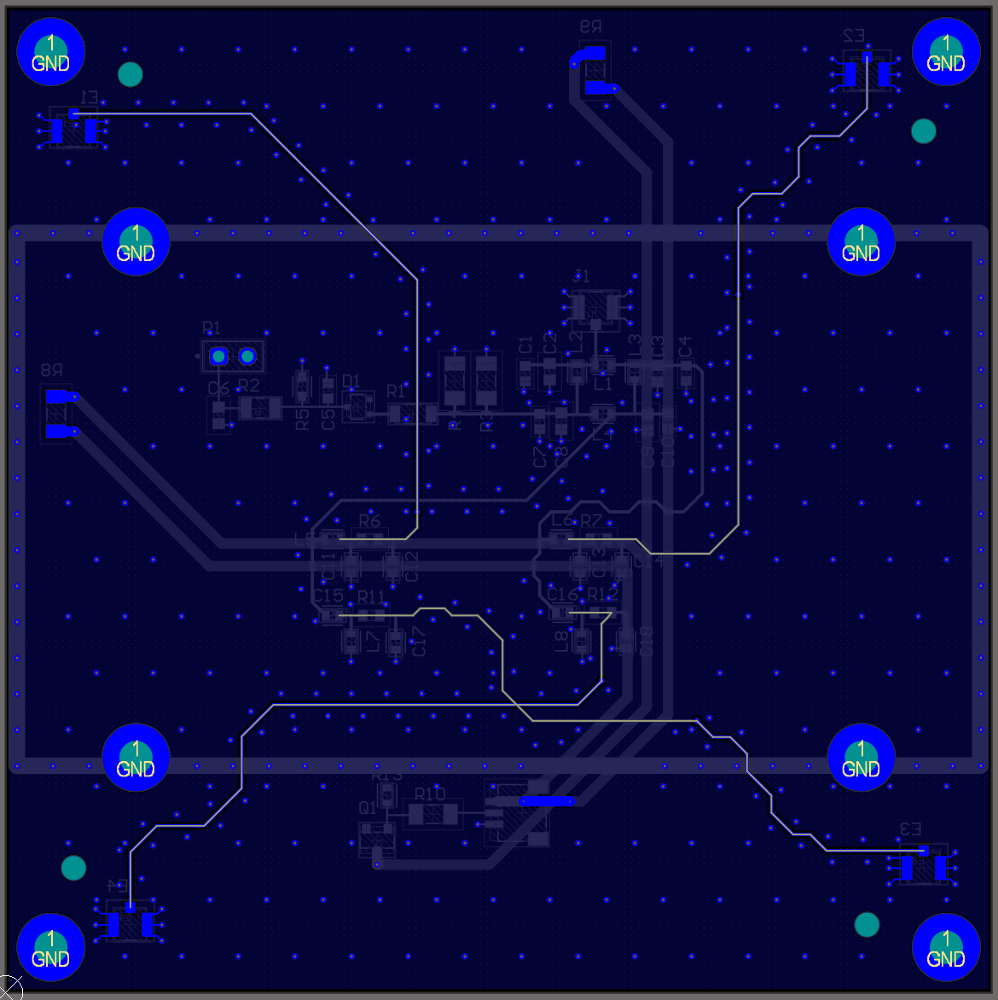 |

---

## Roadmap

- [x] Transceiver schematic and 4-layer layout
- [x] Antenna board schematic and 4-layer layout
- [x] Module mechanical concept (shield frame, hinges, tape elements)
- [ ] Final design review and fabrication
- [ ] Transceiver bring-up: power rails, MCU, clock, telemetry
- [ ] RF testing: output power, harmonics and spurious, receive sensitivity, VNA match tuning
- [ ] Antenna testing: hybrid and balun phase/amplitude balance, deployed return loss and axial ratio
- [ ] Deployment testing: burn-wire timing, repeated deployments
- [ ] Firmware and ground-station integration

## Repository layout

```
hardware/transceiver/   transceiver schematic (PDF)
images/transceiver/     transceiver 3D view and layer screenshots
images/antenna/         antenna board 3D view and layer screenshots
images/module/          renders of the assembled module (stowed, deployed, exploded)
```

Design files (Altium projects, Gerbers, BOMs) and test results will be added as the project progresses.

## Author

**Rayaan Atif** - Engineering & Physics, Curtin University, Perth, Australia.
Member of the Perth Aerospace Student Team and the Binar Space Program (BinarX). QUASAR is a personal project and is not affiliated with either.
